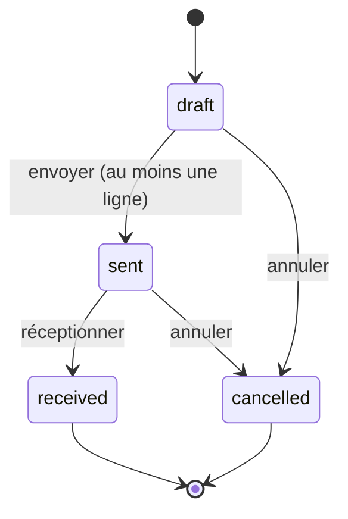

# Shop Stock Manager


Application en ligne de commande de gestion de stock et de réapprovisionnement : suivi des produits, alertes de rupture,
suggestions de commandes, commandes fournisseurs avec cycle de vie et historique complet des mouvements.

## Contexte

Une boutique en ligne perd des ventes à cause de ruptures de stock, et ses réapprovisionnements se décident sans méthode.
L'outil indique quoi commander et à qui, regroupe les besoins par fournisseur et garantit la cohérence du stock.

## Fonctionnalités

- Gestion des produits : référence unique, prix, seuil d'alerte, fournisseur rattaché
- Mouvements de stock tracés avec leur motif ; le stock ne peut jamais devenir négatif
- Alertes de réapprovisionnement, valorisation du stock, export CSV
- Commandes fournisseurs : `brouillon → envoyée → reçue`, annulation possible avant réception
- Suggestions de quantités et génération automatique d'un brouillon par fournisseur
- Réception **atomique** : toutes les lignes entrent en stock dans une seule transaction, ou aucune

## Processus de réapprovisionnement



Les règles de gestion (RG-01 à RG-10), le modèle de données et les user stories sont dans
[`docs/analyse-et-conception.md`](docs/analyse-et-conception.md).

## Installation

Prérequis : Python 3.9 ou supérieur, sans dépendance externe.

```bash
git clone https://github.com/Say223/shop-stock-manager.git
cd shop-stock-manager
```

## Utilisation

```bash
python main.py demo               # charge des produits et fournisseurs de démonstration
python main.py list               # état du stock
python main.py reorder            # produits à commander et quantités suggérées
python main.py reorder-create     # crée un brouillon de commande par fournisseur
python main.py po-list            # liste des commandes
python main.py po-send 1          # envoie la commande n°1
python main.py po-receive 1       # réception : le stock est mis à jour
python main.py history HDP-005    # historique des mouvements d'un produit
```

Exemple de sortie de `reorder` :

```
HDP-005   Casque audio            stock    2  ->  commander   10  (fournisseur #2)
MOU-002   Souris sans fil         stock    3  ->  commander   17  (fournisseur #1)
SCR-004   Écran 27 pouces         stock    4  ->  commander    6  (fournisseur #1)
```

Autres commandes : `add`, `in`, `out`, `low`, `value`, `export`, `delete`, `supplier-add`, `suppliers`, `po-new`, `po-add`, `po-show`, `po-cancel`, `set-supplier`.
L'aide complète est disponible avec `python main.py --help`. La base `stock.db` est créée au premier lancement (option `--db` pour en changer) ; supprimez le fichier pour repartir de zéro.

## Tests

```bash
python -m unittest discover -s tests -t . -v
```

28 tests couvrent les règles métier, les transitions de statut, l'atomicité de la réception (panne simulée) et l'interface en ligne de commande.
Les tests s'exécutent à chaque `push` via GitHub Actions.

## Structure du projet

```
stock/
  db.py          schéma SQL, connexion, migration
  service.py     produits, mouvements, indicateurs
  purchasing.py  fournisseurs, commandes, suggestions
  cli.py         interface en ligne de commande
docs/analyse-et-conception.md   processus, modèle de données, règles de gestion
tests/
main.py
```

Architecture en trois couches : accès aux données, règles métier, interface.

## Choix techniques et limites

- Transactions SQLite pour garantir la cohérence ; contraintes `CHECK` et clés étrangères en seconde ligne de défense.
- Pas de gestion multi-entrepôts ni de livraisons partielles ; interface en ligne de commande uniquement.

## Pistes d'évolution

Livraisons partielles, prévision de la demande à partir de l'historique, interface web ou API REST au-dessus du service existant.

