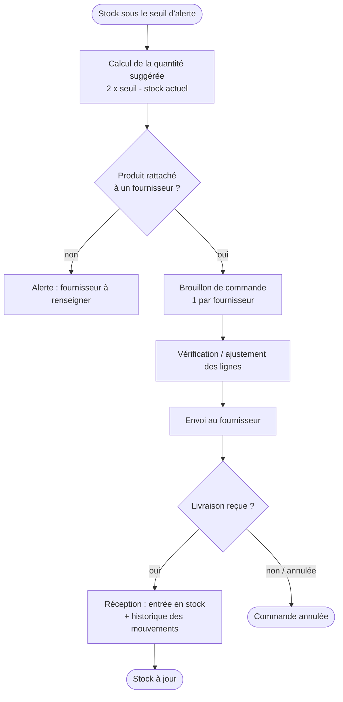
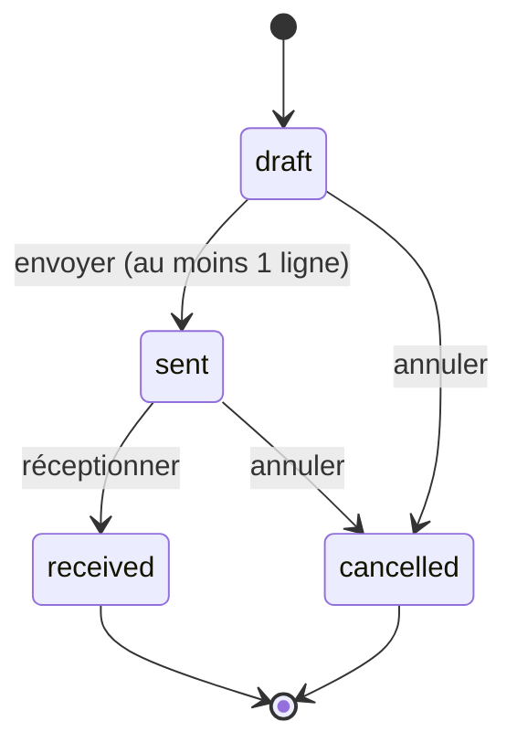
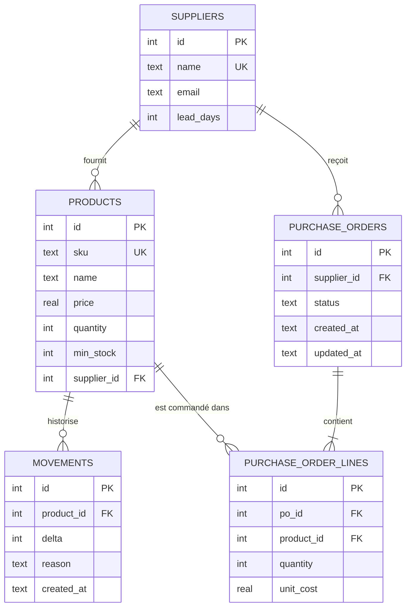

# Analyse et conception

## Contexte métier
Une boutique d'électronique subit des ruptures de stock : les réapprovisionnements se décident « au feeling »
et se suivent dans des e-mails. Objectif : **savoir ce qu'il faut commander, à qui, et tracer chaque mouvement**.

## Acteurs
- **Gestionnaire de stock** : enregistre les entrées/sorties, surveille les alertes, prépare les commandes.
- **Responsable achats** : valide et envoie les commandes aux fournisseurs, réceptionne les livraisons.

## Processus de réapprovisionnement

## Cycle de vie d'une commande fournisseur

## Modèle de données (MCD)

## Règles de gestion
| Code | Règle |
|---|---|
| RG-01 | La référence (SKU) d'un produit est unique ; prix, quantité et seuil sont positifs. |
| RG-02 | Le stock ne peut jamais devenir négatif : une sortie trop grande est refusée. |
| RG-03 | Une commande vide ne peut pas être envoyée. |
| RG-04 | Seule une commande en brouillon est modifiable. |
| RG-05 | Transitions autorisées : brouillon → envoyée → reçue ; annulation possible avant réception. |
| RG-06 | Un seul brouillon ouvert par fournisseur : les suggestions s'y ajoutent, sans doublon. |
| RG-07 | Quantité suggérée = 2 × seuil d'alerte − stock actuel (minimum 1). |
| RG-08 | La réception d'une commande est **atomique** : toutes les lignes entrent en stock, ou aucune. |
| RG-09 | Un produit présent dans une commande ne peut pas être supprimé (intégrité et traçabilité). |
| RG-10 | Chaque variation de stock est historisée avec sa raison. |

## User stories (extraits)
- En tant que **gestionnaire**, je veux voir les produits sous leur seuil afin d'éviter les ruptures.
- En tant que **gestionnaire**, je veux une suggestion de quantités à commander afin de gagner du temps.
- En tant que **responsable achats**, je veux un brouillon par fournisseur afin de valider avant envoi.
- En tant que **responsable achats**, je veux que la réception alimente le stock automatiquement afin d'éviter les doubles saisies.
- En tant que **gestionnaire**, je veux l'historique des mouvements afin de comprendre un écart d'inventaire.

## Choix techniques
- Architecture en 3 couches : `db.py` (données) → `service.py`/`purchasing.py` (règles métier) → `cli.py` (interface).
- Transactions SQLite pour garantir la cohérence (RG-08) ; contraintes `CHECK`/`FOREIGN KEY` en seconde ligne de défense.
- Pas de dépendance externe : exécution identique sur tous les postes.

## Limites et évolutions possibles
Pas de gestion multi-entrepôts ni de livraisons partielles ; une interface web ou une API (voir le projet helpdesk-api) serait l'étape suivante.
